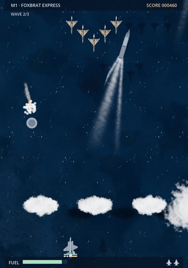

# Air Superiority Complex

<p align="center"><a href="https://ahab94.github.io/air-superiority-complex/"></a></p>

<p align="center"><b><a href="https://ahab94.github.io/air-superiority-complex/">▶ Play free in your browser</a></b></p>

A satirical arcade shooter in the style of Space Invaders. The jets are parodies of real ones, the countries are made up, and every mission is based on a real incident or a famous dogfight. Play solo, or a friend can drop in for local co-op at any time.

> "So there I am, Bearovia, '76. Fastest jet on Earth, fuel tank of a lawnmower..."
> Bartender: "Sure, Ace."

Made in Godot 4.7 with GDScript, in real-time 3D seen from above. The jets are modelled in code, with metal skins, camo and parody roundels, flying over an animated sea. Explosions use fire, smoke and light. There are no image or model assets.

## Play

**▶ [Play in your browser](https://ahab94.github.io/air-superiority-complex/)**. It works on phones too, with on-screen controls.

Install with one line:
- **macOS / Linux:**
  ```bash
  curl -fsSL https://raw.githubusercontent.com/ahab94/air-superiority-complex/main/install.sh | bash
  ```
- **Windows (PowerShell):**
  ```powershell
  irm https://raw.githubusercontent.com/ahab94/air-superiority-complex/main/install.ps1 | iex
  ```

You can also download a build from [Releases](https://github.com/ahab94/air-superiority-complex/releases), or run from source with `godot --path .` (Godot 4.7).

| | Ace (player 1) | Deuce (player 2, optional) |
|---|---|---|
| Fly | WASD, or Arrows when solo | Arrows |
| Touch | Drag on the left to fly; Fire, Missile and Flare buttons on the right | |
| Cannons | Space | Enter |
| Missiles (hold to lock, release to fire) | Left Shift or E | Right Shift |
| Flares (decoy incoming missiles) | F or Q | / |
| Join | | Press Enter at any time |
| Gamepad | Pad 1 | Pad 2 (A joins and fires) |

Esc pauses (Resume, Restart, Mission select, Options, Main menu). M toggles music. Quit from the title screen.

**Co-op rules.**
- The two pilots share a pool of spare jets.
- When one pilot is shot down, they eject instead of losing a jet. If the wingman flies through the parachute, the pilot is back in the air with no jet lost.

## The premise

**Ace** is a freelance fighter pilot who has worked for every air force. Each mission is one of Ace's stories, told to a bartender who doesn't believe a word of it. In co-op, Ace's wingman **Deuce** tells a different version of the same story.

After every mission, a **"The real story"** card gives the actual history in one or two neutral sentences.

### Countries
All made up: **Amerigo**, **Bearovia**, **Great Brollytain**, **Dragonia**, **Dunesia**, **Tangentina**, **the Sunrise Isles**, and the twins **Bordaria and Borderia** (both always win).

### Jets
Every jet is fictional, and every name is a parody. Like the aircraft in big open-world games, each 3D model blends two or three real-world *types* (an interceptor, a delta-wing fighter, a spy glider), so it reads as that kind of jet without copying any one design.

| Jet | Maker | Character |
|---|---|---|
| MyG-52 Foxbrat | Mikoyanov | Very fast in a straight line; turning is a group decision |
| MyG-12 Fishbowl | Mikoyanov | Small, nimble, cheap, everywhere |
| MyG-51 Fishcake | Mikoyanov | Big cannons, small manners |
| 68-F Butterknife | North Amerigan | Six guns and a can-do attitude |
| 2-U Dragon Laddie | Lockjaw Marvin | Unarmed spy glider; one camera |
| RS-17 Blackbirb | Lockjaw Skunkery | Unarmed; outruns missiles on afterburner |
| PF-61 Fighting Pigeon | Lockjaw Marvin | Agile, sleek, coos under heavy g |
| UT-59 Tuba Grizzly | Tupolove | Four-prop boss bomber with tail guns |
| Hawkward Poacher | Hawkward | Graceful, reliable, slightly apologetic |
| Fallin' Midge | Fallin' | Tiny; enemies check their windscreens for bugs |
| 401-F Starfrighter | Lockjaw | A missile with a man in it |
| Dassalt Raffle | Dassalt | Every ticket's a winner |
| C-01J Mildly Vigorous Dragon | Dragonia Aero | Some assembly required |

## Missions: 15 built (of 20 planned)

Each mission has its own terrain, weather, jets and a rule that comes from its setting.

| # | Mission | Terrain, light, weather | You fly → against | Setting's effect |
|---|---|---|---|---|
| 1 | Foxbrat Express (1976) | Ocean, coast; day | MyG-52 Foxbrat → Fishbowls | Fuel; land on the coast |
| 2 | Spy-in-the-Sky (1960) | Steppe farmland, rivers | 2-U Dragon Laddie (unarmed) | SAM sites fire from the ground; photograph 4 of 6 sites |
| 3 | Butterknife Alley (1951) | Winter taiga, frozen river; overcast, snow | 68-F Butterknife → MyG-51 Fishcakes | Sanctuary: no firing across the river |
| 4 | Speed Check (1979) | Desert canyons and mesas; dusk, dust | RS-17 Blackbirb (unarmed) | Afterburner outruns missiles; the engine overheats |
| 5 | Grin and Bear It (1985) | Arctic sea ice; low sun, snow | PF-61 Fighting Pigeon → **UT-59 Tuba Grizzly boss** | Icing: the jet slides |
| 6 | Five in a Minute (1965) | Plains, fields and canals; dust | Butterknife (for Borderia) → Hawkward Poachers | Ground flak; combo bonus; Kills vs Claimed |
| 7 | Midge Attack (1971) | Jungle delta; storm, rain, lightning | Fallin' Midge (for Bordaria) → Butterknifes | Monsoon wind and turbulence; tiny jet |
| 8 | Starfrighter (1971) | Desert at night | Fishbowl (Bordaria) → 401-F Starfrighters | Night; frequent heat-seekers |
| 9 | Coffee, Two Sugars (2019) | High mountains with real relief; snow | Fishbowl (Bordaria) → Fighting Pigeons | Turbulence; steer your parachute home, or you're staying for coffee |
| 10 | Beyond Visual Reason (2025) | Night plains, town lights | Raffle ⇄ Vigorous Dragon | Missiles only across the Line; Ace switches sides at halftime |

**Chapter 3: Greatest Hits**

| # | Mission | Terrain, light, weather | You fly → against | Setting's effect |
|---|---|---|---|---|
| 11 | Operation Bowl-o (1967) | Jungle; day | FN-4 Fantom → Fishbowls | **Disguise:** you look like a slow bomber, so they close in without firing. Ambush them for double points |
| 12 | The Ace Who Wasn't (1972) | Misty karst hills; overcast | Fantom → Colonel Nobody | **A phantom ace** who blinks in and out; you can only hit him while he's solid |
| 13 | A Line, Allegedly (1981) | Sea at dusk | TK-41 Tomkitten → SK-22 Fitterbugs | **Rules of engagement:** weapons hold until they fire first; three violations is a court martial |
| 14 | Sea Harrumph (1982) | Stormy ocean, rain | Sea Harrumph → Dassalt Mirth IIIs | **Attacks from behind:** pull back to air-brake and they overshoot |
| 15 | The Kill Chain | Above a sea of clouds | F-53½ Lightning… Eventually → WA-3 Big Ear + stealth fighters | **Kill chain:** radar planes cloak their fighters in stealth camo; shoot down the Big Ears to unveil them |

Missions unlock as you win them. On the briefing card, Left and Right pick any unlocked mission.

Missions 16–20 are still to build.

**Chapter 3: Greatest Hits**, planned: Operation Bowl-o, The Ace Who Wasn't, Line of Death, Sea Harrumph, Line of Death 2.

**Chapter 4: Not Technically Dogfights**, planned: Red Square Dance, Hainan Fender-Bender, Fuel Dump-ster, 99 Problems But a Balloon, Has Anyone Seen Our Jet?

### Tone guardrails
- No civilian tragedies and no strike damage on screen. The comedy is about jets and bureaucracy.
- No real country, jet or person is named anywhere in the game, including the "real story" cards, which describe events indirectly.
- References stay indirect (a coffee, not the famous drink).
- Bordaria and Borderia jokes always come in matched pairs, so neither side gets singled out.
- No real insignia, and no real designations or trademarks in the game. Silhouettes are stylized.

## How it works
- `scripts/sim.gd` contains the whole game as deterministic data and rules: fixed 60 Hz steps and a seeded RNG. There are no nodes in it, so tests run it at full speed.
- `scripts/autopilot.gd` is a computer pilot that forecasts falling bullets and leads its shots against the marching formation. It proves every mission is winnable, flies as the AI wingman, and records footage.
- `scripts/levels.gd` holds the mission data: waves as strings, plus the story text.
- `scripts/game.gd` handles input, drawing, the briefing and end cards, and co-op drop-in.
- `scripts/scene3d.gd`, `scripts/jet_mesh.gd` and `shaders/` render the 3D world: jets, ocean, coast, clouds and explosions. They only read the simulation.

To check everything:

```bash
bash checks/verify.sh
```

It must end with `air-superiority-complex: all good`.
